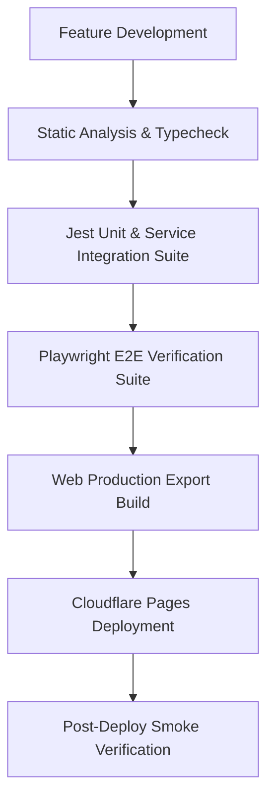

# End-to-End Software Development Pipeline

This document defines the global end-to-end software development lifecycle (SDLC) workflow for POSCursor / POS Cursor.

## Workflow Overview



---

## Stage 1: Local Development & Verification

Before submitting code changes, run the global end-to-end verification pipeline locally:

```bash
# Run full local verification (Typescript + Jest + Playwright + Web Build)
npm run workflow:e2e
```

To include Cloudflare Pages deployment in the local run:
```bash
npm run workflow:e2e -- --deploy
```

---

## Stage 2: Automated CI/CD Pipeline

When code is pushed to `main` or a pull request is opened, GitHub Actions automatically executes [`.github/workflows/ci-cd.yml`](file:///e:/GitHub/POS Cursor/.github/workflows/ci-cd.yml):

1. **Static Analysis & Type Check**:
   - Executes `npx tsc --noEmit`
   - Validates schema and imports
2. **Jest Unit & Integration Suite**:
   - Executes `npm test -- --coverage --ci --maxWorkers=2`
   - Uploads test coverage artifacts
3. **Playwright E2E Suite**:
   - Executes `npx playwright test`
   - Uploads Playwright HTML test reports
4. **Build & Production Deployment**:
   - Executes `npm run export:web:production`
   - Deploys static build output (`dist/`) directly to Cloudflare Pages (`jetfarm.pages.dev`)

---

## Stage 3: Post-Deployment Smoke Check

Verify live production deployment:

1. **URL**: `https://jetfarm.pages.dev`
2. **Key Checkpoints**:
   - Application loads without SPA routing errors (`_redirects` active)
   - Supabase sync initializes clean local WatermelonDB instance
   - Role authentication (Admin, Collector, Encoder, Borrower) works correctly
   - **Accounting Transaction Connection & Financial Statement Reconciliation**:
     - All outside-accounting transactions (Cash on Hand, Cash in Bank, Share Capital/CBU, Savings deposits & withdrawals, Expenses) auto-post double-entry journal entries into General Ledger (`journal_entries`).
     - Financial reports & statements (Balance Sheet, Income Statement, Statement of Cash Flows, Statement of Changes in Equity, Trial Balance) aggregate and reflect 100% of live production DB data accurately.
     - Admin Accounting Overview screen (`app/(admin)/accounting/index.tsx`) includes functional "Reconcile DB" action to trigger real-time auto-posting backfill.
     - UI/UX encoding screens and modals (Petty Cash, Expenses, Savings, Share Capital) properly record data and post to accounting.

